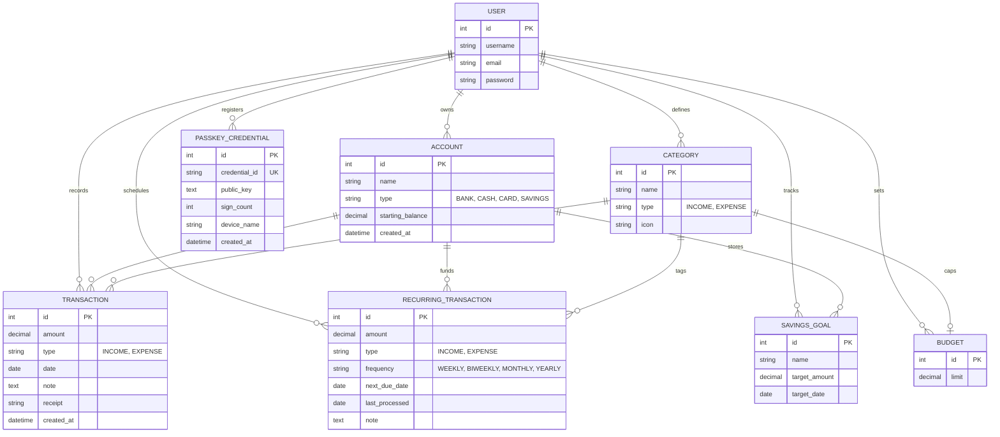

# 💸 SpendWise — Personal Finance Tracker & Cash-Flow Planner

> **Portfolio project**  
> A Django personal-finance tracker focused on NGN budgeting, account balances, spending history, and passkey authentication.

[](https://python.org)
[](https://djangoproject.com)
[](https://tailwindcss.com)
[](https://fidoalliance.org)

---

## 📌 Executive Summary & Engineering Motivation

SpendWise is a personal-finance project for recording accounts and transactions, setting category budgets, and tracking savings goals. It is designed for NGN-based use and does not connect to bank accounts.

Implemented capabilities include decimal-based account calculations, user-scoped Django views, category budgets, recurring-payment schedules, CSV transaction import/export, and optional WebAuthn passkeys. The dashboard includes an indicative 90-day projection based on the user's recent average net cash flow; it is not a financial forecast or guarantee.

---

## 🏛️ System Architecture

SpendWise is a Django application with server-rendered pages, user-scoped financial records, and JavaScript enhancements for interactive charts and selected actions.

```
SpendWise Architecture
├── Presentation: Django templates, Tailwind CSS, and JavaScript
├── Application: Django views, forms, authentication, and financial calculations
├── Authentication: Django sessions and optional WebAuthn passkeys
└── Storage: SQLite for local development; PostgreSQL on the Render blueprint
```

---

## ⚡ Complete Feature Matrix & Capabilities

### 1. 🎛️ Global Command Palette (`⌘K` / `Ctrl+K`)
- Floating spotlight interface accessible anywhere with `Cmd + K` or `Ctrl + K`.
- Keyboard-first navigation: jump between Ledger, Envelopes, Predictive Runway, Reports, and Account Settings without touching the mouse.
- Quick actions: Launch the Bill Splitter, toggle Privacy Mode, trigger Quick Add (`N`), or view shortcut cheatsheets (`?`).

### 2. 🏦 NGN Account Ledger
- Track cash, bank, card, and savings accounts with opening balances and transactions.
- All balances are currently treated as NGN. Account-specific currencies and exchange-rate conversion are not implemented.

### 3. 🎯 Smart Budget Envelopes & "Safe-to-Spend" Dial
- **Safe-to-Spend estimate**: Divides remaining category budget after current-month recorded spending and scheduled recurring expenses by the remaining calendar days. It is an estimate, not a guarantee.
- **Historical 30-Day Insight**: Contextual helper card showing exact past 30-day spend when configuring budget envelopes.
- **Envelope Controls**: Monthly category usage bars with near-limit (80%) and over-budget alerts.

### 4. 📊 Indicative 90-Day Cash-Flow Projection
- Projects account balance using the average daily net income/expense recorded over the trailing 90 days.
- The dashboard labels this as an estimate and shows no projection until there is transaction history.

### 5. 🧾 Intelligent Transaction Ledger & Slide-Over Drawer
- Search notes, categories, account names, and exact amounts; filter by type, account, and date range.
- **Click-to-Inspect Drawer**: Clicking any ledger entry slides open a detailed transaction drawer from the right screen edge.
- **Live Inline Updates**: Edit transaction note, category, account, or amount in real-time with instant AJAX patch verification.
- **Intelligent Subtitles**: Automatically displays merchant/note as the primary title with clean subtext formatting (`Oct 2, 2026 · Main Checking · Groceries`) without repeating categories.
- **Sanitized Deletion**: One-click asynchronous deletion with optimistic DOM removal.

### 6. 🤝 Interactive Bill Splitting & Shared IOUs
- Split shared dinner checks, housing rent, or utility bills with customizable tip percentages and participant counts.
- **1-Click WhatsApp Export**: Formats a clean, copyable summary ready to send into group chats.
- **Ledger IOU Integration**: Adjusts the parent transaction down to the user's personal share and automatically records the balance as an active claim under `"IOU & Reimbursements"`.

### 7. 🔐 WebAuthn / Passkey Biometric Hardware Authentication
- Users can create an account with a discoverable passkey or add passkeys to an existing account.
- Assertions and registrations are validated server-side using WebAuthn challenge, origin, relying-party ID, and public-key signature checks.
- Credentials are stored as public keys and counters; private keys stay with the authenticator (Windows Hello, Touch ID, Face ID, or security keys).
- For deployments behind a proxy, configure `WEBAUTHN_RP_ID` and `WEBAUTHN_ORIGIN`; WebAuthn requires HTTPS except on localhost.

### 8. 💬 Personalized Money Coach
- Shows recorded account balance, month-to-date spending, and the highest-spend category for the signed-in user.
- Uses Groq-hosted chat completions to answer general chat and financial questions conversationally, grounded in the user's recorded account balance, month-to-date spending, remaining monthly category budgets, and highest-spend category.
- Configure `GROQ_API_KEY` in the local `.env` file and in the production host's environment variables. `GROQ_MODEL` defaults to `openai/gpt-oss-120b` and can be changed to another model enabled for the Groq account.
- The coach sends only those financial summary figures and the current chat messages to Groq; it does not send the transaction ledger, account names, or login credentials. Users should not enter passwords or banking credentials into chat. AI replies can be inaccurate and are educational, not professional financial advice. Without `GROQ_API_KEY`, the chat reports that it is not configured rather than returning a fake AI answer.
- Create an API key in [Groq Console](https://console.groq.com/keys), add it to `.env` locally, and add `GROQ_API_KEY` as a secret environment variable in Render. Set `GROQ_MODEL` to an active model available to your account. Never commit or paste the key into browser code or chat. The endpoint limits each signed-in user to 20 coach requests per 10 minutes.

### 9. 👁️ One-Click Privacy Mode (`Ctrl + P` / Eye Toggle)
- Non-destructive client-side privacy shield applying `filter: blur(8px)` across all `.currency-val` elements.
- State persists in `localStorage` with inline boot scripts to prevent content flash during page loads.
- Perfect for working in university libraries, cafes, or presenting over screen shares.

### 10. 📸 Receipt Attachments
- Transaction forms support receipt image attachments.
- Automatic OCR is not implemented; the receipt helper says so rather than inventing extracted values.

### 11. 🔁 Recurring Commitments & Subscriptions
- Track weekly, biweekly, monthly, and yearly commitments and see upcoming due dates.
- Monthly commitment totals normalize each schedule frequency; scheduled entries are not automatically posted as transactions.

### 12. 🔒 Savings Goals
- Set a savings target linked to an account and track its target date.
- Progress uses the linked account's full current balance; goals do not earmark, reserve, or transfer money.

### 13. 🛡️ Data Sovereignty & Audit Tools
- **Sanitized CSV Export**: Automatically escapes dangerous formula characters (`=`, `+`, `-`, `@`) to protect against Excel CSV injection attacks.
- **JSON transaction export**: Download the user's transaction records.
- **CSV transaction importer**: Import compatible transaction rows; invalid rows are skipped.

---

## 🗄️ Database Schema & Data Models



---

## 🛡️ Security & Defensive Engineering

| Threat Vector | Mitigation Strategy Implemented in SpendWise |
|---|---|
| **Account ownership** | Financial views scope records to the authenticated user; tests cover cross-user account visibility. |
| **CSV formula injection** | CSV export escapes formula-leading cell values before writing rows. |
| **Passkey verification** | WebAuthn challenges and signatures are verified server-side; a regression test ensures an invalid assertion does not authenticate a user. |
| **Financial arithmetic** | Monetary values and balance calculations use Python `Decimal` rather than binary floating point. |
| **Sensitive balance display** | Privacy mode visually blurs amounts in the browser. This is a presentation feature, not an access-control or encryption boundary. |

---

## 🛠️ Technology Stack

| Layer | Technologies |
|---|---|
| **Backend Framework** | Python 3.10+, Django 5+ |
| **Database** | SQLite (Development) / PostgreSQL via `dj-database-url` (Production) |
| **Frontend Styling** | Tailwind CSS v4.3 (JIT CLI compiler, custom `@theme` palette) |
| **Frontend Scripting** | Vanilla JavaScript |
| **Authentication** | Django Auth (PBKDF2-SHA256) + W3C WebAuthn / FIDO2 Hardware Biometrics |
| **Static Assets** | WhiteNoise |

---

## 🚀 Getting Started & Local Setup

### Prerequisites
- **Python 3.10+** (Tested on Python 3.12)
- **Node.js 18+** & **npm** (For Tailwind CSS v4 compiler)
- **Git**

### Installation

1. **Clone the Repository**:
   ```bash
   git clone https://github.com/your-username/spendwise.git
   cd spendwise
   ```

2. **Set Up Python Virtual Environment**:
   ```bash
   # Windows
   python -m venv venv
   .\venv\Scripts\activate

   # macOS / Linux
   python3 -m venv venv
   source venv/bin/activate
   ```

3. **Install Dependencies**:
   ```bash
   pip install -r requirements.txt
   npm ci
   ```

4. **Run Migrations & Compile Assets**:
   ```bash
   python manage.py migrate
   npm run build
   python manage.py collectstatic --noinput
   ```

5. **Optional: Seed Demo Data**:
   This command creates a `demo` user with sample records. Do not run it in production. If a `demo` user already exists, the command deletes that user and recreates the demo account.
   ```bash
   python manage.py seed_demo
   ```

6. **Launch the Development Server**:
   ```bash
   python manage.py runserver
   ```
   Open your browser to: **`http://localhost:8000`** (or `http://127.0.0.1:8000`).

### Optional local WebAuthn test domain

To test a different RP label on Windows, add `127.0.0.1 spendwise.test` to `C:\Windows\System32\drivers\etc\hosts` using an elevated editor. Serve `spendwise.test` over HTTPS with a locally trusted development certificate and a local TLS reverse proxy to Django; browsers only treat `localhost` as a secure HTTP origin by default, not arbitrary hosts-file names.

Set the local environment to `ALLOWED_HOSTS=spendwise.test`, `CSRF_TRUSTED_ORIGINS=https://spendwise.test:8000`, `WEBAUTHN_RP_ID=spendwise.test`, and `WEBAUTHN_ORIGIN=https://spendwise.test:8000` (use the actual external HTTPS port, or omit it for port 443). `WEBAUTHN_RP_ID` is only the bare host name; `WEBAUTHN_ORIGIN` is the full HTTPS origin. Open the site using that exact host and origin. Passkeys registered for `localhost` are scoped to a different RP ID and must be registered again for `spendwise.test`.

---

## 🚀 Deploying to Render

The repository includes a `render.yaml` Blueprint for a Django web service and PostgreSQL database. Push the project to GitHub, create a Blueprint from the repository in Render, review the generated resources, and apply it. The configured build script installs dependencies, builds Tailwind assets, collects static files, and applies migrations.

Render generates the production `SECRET_KEY` and connects the managed PostgreSQL database through the Blueprint. Production startup requires a PostgreSQL `DATABASE_URL` and will fail rather than silently falling back to non-persistent SQLite. For a custom domain, set `WEBAUTHN_RP_ID` to the domain and `WEBAUTHN_ORIGIN` to its HTTPS origin so passkeys use the same origin as the deployed site.

Passkey QR codes are generated by the browser, not SpendWise. To use a phone, select “Use another device” in the browser's passkey prompt, keep Bluetooth enabled, and scan with the phone's camera while the prompt remains open. The QR is a secure passkey handoff, not a website URL; a general scanner or Google Lens can display its encoded text instead of opening a sign-in page. A matching passkey for this site's domain must already exist on the phone.

Receipt uploads are stored on the web service's local media directory. They are not guaranteed to persist across service replacement or redeployment; configure persistent storage before relying on receipt attachments in production.

Password reset uses Django's built-in one-time reset tokens. To send reset emails through Gmail, create a Google App Password (with 2-Step Verification enabled), then set `EMAIL_HOST=smtp.gmail.com`, `EMAIL_PORT=587`, `EMAIL_USE_TLS=True`, `EMAIL_USE_SSL=False`, `EMAIL_HOST_USER` to your Gmail address, `EMAIL_HOST_PASSWORD` to the 16-character App Password, and `DEFAULT_FROM_EMAIL` to that Gmail address. Do not use your normal Gmail password or commit the App Password. Locally, add these to `.env`; in Render, add them under the web service's Environment settings. Until SMTP credentials are configured, development prints email to its console and production does not send or log reset emails.

Google and Apple sign-in use django-allauth and only appear on the login page after the matching provider credentials are configured. For Google, create a Web OAuth client in Google Cloud Console, add your deployed origin to Authorized JavaScript origins, and add `https://YOUR-SERVICE.onrender.com/oauth/google/login/callback/` to Authorized redirect URIs. Set `GOOGLE_OAUTH_CLIENT_ID` and `GOOGLE_OAUTH_CLIENT_SECRET` in Render.

For Apple, create a Sign in with Apple Services ID and a Sign in with Apple key in the Apple Developer account. Register the domain and return URL `https://YOUR-SERVICE.onrender.com/oauth/apple/login/callback/` for the Services ID. Set `APPLE_OAUTH_CLIENT_ID` to the Services ID, plus `APPLE_OAUTH_KEY_ID`, `APPLE_OAUTH_TEAM_ID`, and `APPLE_OAUTH_PRIVATE_KEY` (the downloaded `.p8` key contents) in Render. Apple web sign-in requires an eligible Apple Developer account and a verified HTTPS domain. The private key can be entered with literal `\n` line breaks; SpendWise expands them at startup.

For a custom domain, replace the `YOUR-SERVICE.onrender.com` host in the provider callback URLs with your production hostname and include it in `ALLOWED_HOSTS`. Social sign-in callbacks are under `/oauth/` because the built-in `/accounts/login/` path redirects to SpendWise's custom login page. Run database migrations after deploying; the Render build script does this automatically.

---

## 🧪 Automated Testing & Verification

Run the Django test suite with:

```bash
python manage.py test
```

The suite covers account ownership visibility, decimal balance calculations, budget spending, CSV import/export, category deletion, passkey verification and registration, dashboard calculations, the personalized money-coach endpoints, and the HTTPS proxy origin used by passkeys.

---

## ⌨️ Keyboard Shortcuts Reference

| Shortcut | Action |
|---|---|
| `⌘K` / `Ctrl + K` | Open Global Command Palette |
| `Ctrl + P` | Toggle One-Click Privacy Mode (Blur Balances) |
| `N` | Quick Add New Transaction |
| `?` | Open Keyboard Shortcuts Cheat Sheet |
| `Esc` | Close Any Modal, Drawer, or Palette |

---

## 👨‍💻 Engineering Author & Portfolio Notes

**SpendWise** was conceived, architected, and built by a **Computer Engineering student** passionate about building robust, high-performance distributed systems, cryptographic security, and human-centric software.

Key engineering takeaways demonstrated in this project:
- **Progressive Enhancement**: Server-rendered Django pages with JavaScript for interactive charts and selected UI workflows.
- **Hardware-Software Interface**: Bridging browser Web APIs with hardware biometrics (TPMs, Touch ID, Windows Hello) via W3C WebAuthn.
- **Financial Data Integrity**: Decimal-based currency calculations and CSV export escaping for spreadsheet formula characters.
